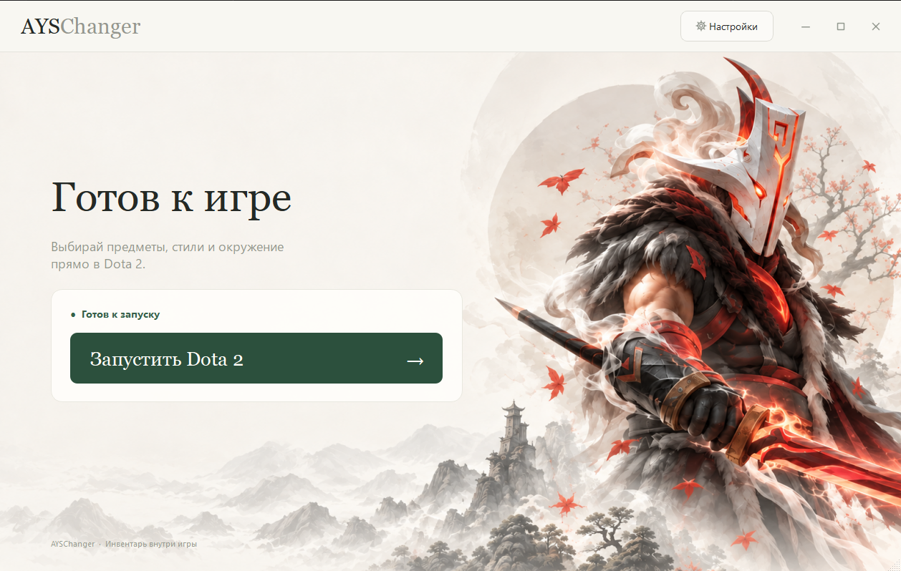

# AYSChanger

### Любимый образ героя — прямо в Dota 2

Бесплатный ченджер · Публичная тестовая версия

**[⬇️ Скачать AYSChanger для Windows](https://github.com/regngod/AYSChanger/releases/latest/download/AYSChanger.exe)**

[История обновлений](https://github.com/regngod/AYSChanger/releases) · [Сообщить об ошибке](https://github.com/regngod/AYSChanger/issues)

---

## 🎬 Посмотрите разницу

https://github.com/user-attachments/assets/96395290-d9e8-4b7b-b011-0f1d2d713c06

## ✨ Ваш герой — ваш стиль

Выбирайте и надевайте косметические предметы прямо в инвентаре Dota 2.
Скины применяются только к вашему герою — облик других игроков не меняется.

## 🚀 Начните за четыре шага

1. Скачайте и откройте **AYSChanger.exe**.
2. Если папка Dota 2 не определилась автоматически, укажите её в настройках.
3. Запустите игру через лаунчер и подождите **10–30 секунд**.
4. Выбирайте и надевайте предметы в инвентаре самой Dota 2.

## 🧪 Помогите сделать AYSChanger лучше

Это первая публичная тестовая версия. Нашли ошибку? [Создайте обращение](https://github.com/regngod/AYSChanger/issues) и опишите, что произошло. По возможности приложите скриншот.

## 🔄 Всегда актуальная версия

Мы обновляем AYSChanger вслед за обновлениями Dota 2. Кнопка скачивания ведёт на последний релиз, а список изменений доступен в [Releases](https://github.com/regngod/AYSChanger/releases).
